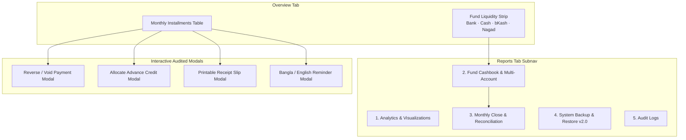

# 📘 KC-Kisti Payment Tracker — Project Documentation

> **Project Name:** KC-Kisti Payment Tracker  
> **Repository:** `KC-Kisti_Payment`  
> **Live Deployment:** [kc-kisti-payment-tracker.vercel.app](https://kc-kisti-payment-tracker.vercel.app/)  
> **Technology Stack:** HTML5, CSS3, Vanilla JavaScript (ES6+), Firebase Firestore (Realtime DB), Service Worker (PWA), FontAwesome 6  
> **Timezone Standard:** `Asia/Dhaka` (GMT+6)  
> **Currency Precision:** Bangladeshi Taka (`৳`, BDT) with Integer Poisha Arithmetic  

---

## 📑 সূচিপত্র (Table of Contents)
1. [প্রকল্পের মূল উদ্দেশ্য ও স্থাপত্য](#1-প্রকল্পের-মূল-উদ্দেশ্য-ও-স্থাপত্য)
2. [মূল ফিক্সসমূহ (Bug Fixes - A1 থেকে A4)](#2-মূল-ফিক্সসমূহ-bug-fixes---a1-থেকে-a4)
   - [A1. অডিট টাইমস্ট্যাম্প ফরম্যাটিং](#a1-অডিট-টাইমস্ট্যাম্প-ফরম্যাটিং)
   - [A2. সুসংগত স্ট্যাটাস পরিভাষা ও ক্রেডিট ডিসপ্লে](#a2-সুসংগত-স্ট্যাটাস-পরিভাষা-ও-ক্রেডিট-ডিসপ্লে)
   - [A3. সাইকেল ডিউ ডেট ও সীমানা নীতি](#a3-সাইকেল-ডিউ-ডেট-ও-সীমানা-নীতি)
   - [A4. ক্যালকুলেটর ব্যাখ্যা ও নিরপেক্ষ ডিসক্লেইমার](#a4-ক্যালকুলেটর-ব্যাখ্যা-ও-নিরপেক্ষ-ডিসক্লেইমার)
   - [A5. অফলাইন মোড ব্যানার ডিসপ্লে ফিক্স](#a5-অফলাইন-মোড-ব্যানার-ডিসপ্লে-ফিক্স)
3. [৮টি প্রধান ফিনটেক ও ম্যানেজমেন্ট মডিউল (Improvements - B1 থেকে B8)](#3-৮টি-প্রধান-ফিনটেক-ও-ম্যানেজমেন্ট-মডিউল-improvements---b1-থেকে-b8)
   - [B1. ফান্ড ব্যালেন্স ও ক্যাশবুক লেজার (Cashbook)](#b1-ফান্ড-ব্যালেন্স-ও-ক্যাশSystem-ক্যাশবুক-লেজার-cashbook)
   - [B2. রিভার্স / ভয়েড পেমেন্ট ওয়ার্কফ্লো (Void / Reversals)](#b2-রিভার্স--ভয়েড-পেমেন্ট-ওয়ার্কফ্লো-void--reversals)
   - [B3. অগ্রিম ক্রেডিট লেজার ও অ্যালোকেশন (Advance Credit)](#b3-অগ্রিম-ক্রেডিট-লেজার-ও-অ্যালোকেশন-advance-credit)
   - [B4. মাসিক ক্লোজ ও অ্যাকাউন্ট রিকনসিলিয়েশন (Monthly Close & Lock)](#b4-মাসিক-ক্লোজ-ও-অ্যাকাউন্ট-রিকনসিলিয়েশন-monthly-close--lock)
   - [B5. অফিশিয়াল পেমেন্ট রিসিট ও ভাউচার (Receipts & PDF)](#b5-অফিশিয়াল-পেমেন্ট-রিসিট-ও-ভাউচার-receipts--pdf)
   - [B6. কাস্টমাইজেবল রিমাইন্ডার ড্রাফট (Reminders)](#b6-কাস্টমাইজেবল-রিমাইন্ডার-ড্রাফট-reminders)
   - [B7. সিস্টেম ব্যাকআপ ও নিরাপদ রিস্টোর (Backup & Restore v2.0)](#b7-সিস্টেম-ব্যাকআপ-ও-নিরাপদ-রিস্টোর-backup--restore-v20)
   - [B8. প্রগ্রেসিভ ওয়েব অ্যাপ (PWA) ও অফলাইন রাইট গার্ড](#b8-প্রগ্রেসিভ-ওয়েব-অ্যাপ-pwa-ও-অফলাইন-রাইট-গার্ড)
4. [মোবাইল ও রেসপনসিভ ইউআই (Mobile-First Experience)](#4-মোবাইল-ও-রেসপনসিভ-ইউআই-mobile-first-experience)
5. [আধুনিক ইনপুট ডিজাইন ও থিম সাপোর্ট (WCAG AA)](#5-আধুনিক-ইনপুট-ডিজাইন-ও-থিম-সাপোর্ট-wcag-aa)
6. [ডেটা সিকিউরিটি ও ইনজেকশন প্রোটেকশন](#6-ডেটা-সিকিউরিটি-ও-ইনজেকশন-প্রোটেকশন)
7. [অটোমেটেড টেস্ট ভেরিফিকেশন ও ফলাফল](#7-অটোমেটেড-টেস্ট-ভেরিফিকেশন-ও-ফলাফল)

---

## 1. প্রকল্পের মূল উদ্দেশ্য ও স্থাপত্য
KC-Kisti Payment Tracker হলো কিস্তিভিত্তিক সমবায় ফান্ড ও ইসলামিক মাইক্রো-ফাইন্যান্স সঞ্চয় ট্র্যাকিংয়ের একটি পূর্ণাঙ্গ প্ল্যাটফর্ম। 

### মূল স্থাপত্য নীতি:
* **জিরো হিস্টোরিক্যাল ডেটা লস:** বেসলাইন ঐতিহাসিক ডেটা (২০২৬ সালের ৮টি সাইকেল, ৭ জন সদস্য, মোট লক্ষ্য ৳৫৬,০০০, আদায় ৳৫১,০০০, বকেয়া ৳৫,০০০) সম্পূর্ণ সংরক্ষিত।
* **পয়সা ইন্টিজার অ্যারিথমেটিক (`toPoisha` / `fromPoisha`):** জাভাস্ক্রিপ্টের ফ্লোটিং-পয়েন্ট রাউন্ডিং সমস্যা (`0.1 + 0.2 = 0.30000000000000004`) রোধ করতে সমস্ত ফান্ড হিসাব ১ টাকার ১০০ ভাগের ১ ভাগ (পয়সা) হিসেবে পূর্ণসংখ্যায় গণনাকৃত।
* **রোল-বেসড এক্সেস কন্ট্রোল (RBAC):** সাধারণ সদস্যদের জন্য পাবলিক রিড-অনলি ভিউ; পেমেন্ট রেকর্ড, ভয়েড, ট্রান্সফার, রিকনসিলিয়েশন এবং ব্যাকআপ শুধুমাত্র অথেনটিকেটেড অ্যাডমিনের জন্য পাসকোড-সুরক্ষিত।

---

## 2. মূল ফিক্সসমূহ (Bug Fixes - A1 থেকে A4)

### A1. অডিট টাইমস্ট্যাম্প ফরম্যাটিং
* **সমস্যা:** অডিট লগে তারিখ বিকৃত হয়ে `2026-10-10 Oct.` আকারে আসত এবং ফায়ারবেস টাইমস্ট্যাম্প সরাসরি অবজেক্ট হিসেবে এরর দিত।
* **সমাধান:** [`formatAuditTimestamp(raw)`](file:///Users/mahfuzulalamrishad/Documents/Project/KC-Kisti_Payment/script.js#L148-L192) ফাংশন যুক্ত করা হয়েছে যা:
  - ফায়ারবেস অবজেক্ট (`{ seconds, nanoseconds }` অথবা `.toDate()`), ISO স্ট্রিং, ইউনিক্স টাইমস্ট্যাম্প এবং ডেট অবজেক্ট নির্ভুলভাবে হ্যান্ডল করে।
  - `Asia/Dhaka` টাইমজোনে স্ট্যান্ডার্ড ফরম্যাট অনুযায়ী রূপান্তর করে: `10 Oct 2026, 10:52 PM BD time`।
  - ঐতিহাসিক ডেটায় সময় না থাকলে অনুমানের বদলে সততার সাথে `"Time not recorded"` প্রদর্শন করে।

### A2. সুসংগত স্ট্যাটাস পরিভাষা ও ক্রেডিট ডিসপ্লে
* **সমস্যা:** বিভিন্ন জায়গায় Pending, Due, Overpaid মিশ্রিত হয়ে মেম্বারদের কনফিউজ করত।
* **সমাধান:** [`normalizePaymentRecord`](file:///Users/mahfuzulalamrishad/Documents/Project/KC-Kisti_Payment/script.js#L308-L362)-এ পরিভাষা সম্পূর্ণ স্ট্যান্ডার্ডাইজ করা হয়েছে:
  - **পেমেন্ট স্ট্যাটাস:** শুধুমাত্র ৩টি মূল অবস্থা — **Unpaid**, **Partially Paid**, এবং **Paid**।
  - **ওভারডিউ (Overdue):** এটি কোনো আলাদা পেমেন্ট স্ট্যাটাস নয়, বরং একটি স্বাধীন শর্ত (Condition) যা কেবল Unpaid বা Partially Paid কিস্তির ক্ষেত্রে ডিউ ডেট অতিক্রান্ত হলে লাল ব্যাজে দিনের সংখ্যাসহ (`Overdue (25d)`) প্রদর্শিত হয়।
  - **সারপ্লাস / অগ্রিম ক্রেডিট:** কোনো কিস্তির নির্ধারিত লক্ষ্যমাত্রার বেশি টাকা পরিশোধিত হলে তা ঋণ না দেখিয়ে আলাদা গ্রিন ব্যাজে `+৳500 Credit` হিসেবে প্রদর্শিত হয়।
  - **ভেরিফিকেশন স্ট্যাটাস:** অ্যাডমিন ভেরিফিকেশনকে পেমেন্ট স্ট্যাটাস থেকে আলাদা পিল হিসেবে রাখা হয়েছে (`Verified Baseline` / `Shared Admin Session`)।

### A3. সাইকেল ডিউ ডেট ও সীমানা নীতি
* **সমস্যা:** নতুন মাস খোলার সময় ডিউ ডেট ছাড়াই সাইকেল শুরু করা যেত এবং ব্যাকফিল অনুমানে পুরনো তারিখে ভুল হিসাব হওয়ার ঝুঁকি ছিল।
* **সমাধান:**
  - অ্যাডমিন যখন নতুন মাসিক সাইকেল তৈরি করবেন, তখন `Asia/Dhaka` সীমানা অনুযায়ী সঠিক তারিখ (`YYYY-MM-DD`) বাধ্যতামূলক করা হয়েছে।
  - পুরনো মাসগুলোর অজানা ডিউ ডেট অপরিবর্তিত রাখা হয়েছে এবং কোনো মনগড়া লেট ফি আরোপ করা হয়নি।

### A4. ক্যালকুলেটর ব্যাখ্যা ও নিরপেক্ষ ডিসক্লেইমার
* **সমস্যা:** ক্যালকুলেটরে ব্যাংক রেট বা নির্দিষ্ট ট্যাক্স (১০%/১৫%) সম্পর্কে অপ্রমাণিত দাবি ছিল এবং জমার টাইমিংয়ের কোনো স্পষ্ট গাণিতিক ব্যাখ্যা ছিল না।
* **সমাধান:**
  - **FDR ক্যালকুলেটর:** চক্রবৃদ্ধির হার অনুযায়ী ডায়নামিক ফর্মুলা ডিসপ্লে: $A = P \times (1 + r/n)^{nt}$ (মাসিক, ত্রৈমাসিক, বার্ষিক চক্রবৃদ্ধি)।
  - **DPS ক্যালকুলেটর:** জমার সময় নির্ধারণী সিলেক্টর (`#dps-timing`):
    - মাসের শুরুতে জমা (Annuity Due): $FV = PMT \times \frac{(1 + r/12)^n - 1}{r/12} \times (1 + r/12)$
    - মাসের শেষে জমা (Ordinary Annuity): $FV = PMT \times \frac{(1 + r/12)^n - 1}{r/12}$
  - ট্যাক্স ও ফি সম্পর্কে নিরপেক্ষ আইনি ডিসক্লেইমার যুক্ত করা হয়েছে: *"হিসাবকৃত ফলাফল নির্দেশক প্রাক্কলন মাত্র। এতে প্রযোজ্য সরকারি আবগারি শুল্ক, উৎসে কর এবং ব্যাংক চার্জ অন্তর্ভুক্ত নয়।"*

### A5. অফলাইন মোড ব্যানার ডিসপ্লে ফিক্স
* **সমস্যা:** ইন্টারনেটে ক্লাউড ডাটাবেজ সচল থাকা সত্ত্বেও স্ক্রিনের শীর্ষে সবসময় হলদে অফলাইন ব্যানার আটকে থাকত।
* **সমাধান:**
  - [styles.css](file:///Users/mahfuzulalamrishad/Documents/Project/KC-Kisti_Payment/styles.css#L11-L15)-এ গ্লোবাল `.hidden { display: none !important; }` এবং `.offline-banner.hidden { display: none !important; }` যুক্ত করা হয়েছে।
  - [script.js](file:///Users/mahfuzulalamrishad/Documents/Project/KC-Kisti_Payment/script.js#L262-L277)-এ `updateOnlineStatusUI()` সরাসরি `style.display = "none"` পরিচালনা করে, যাতে ডিভাইস অনলাইনে থাকলে ব্যানারটি সম্পূর্ণ অদৃশ্য থাকে এবং কেবল সত্যিকারের ইন্টারনেট সংযোগ বিচ্ছিন্নে দৃশ্যমান হয়।

---

## 3. ৮টি প্রধান ফিনটেক ও ম্যানেজমেন্ট মডিউল (Improvements - B1 থেকে B8)



### B1. ফান্ড ব্যালেন্স ও ক্যাশবুক লেজার (Cashbook)
* **মাল্টি-অ্যাকাউন্ট ব্যালেন্স ট্র্যাকিং:**
  - `Islami Bank Bangladesh Ltd (IBBL)` (ব্যাংক অ্যাকাউন্ট)
  - `Cash in Hand` (ক্যাশ ড্রয়ার)
  - `bKash Mobile Wallet`
  - `Nagad Mobile Wallet`
* **লেজার এন্ট্রি ক্যাটাগরি:**
  - **Inflow (+):** সদস্য কিস্তি আদায়, ব্যাংক মুনাফা/প্রফিট ক্রেডিট, মূলধন জোগান।
  - **Outflow (-):** ব্যাংক চার্জ ও আবগারি শুল্ক, পরিচালন ব্যয়, সদস্য ক্যাশ রিফান্ড, এফডিআর বিনিয়োগ।
  - **Linked Internal Transfer (⇄):** এক অ্যাকাউন্ট থেকে অন্য অ্যাকাউন্টে টাকা স্থানান্তর (যেমন: বিকাশ থেকে ব্যাংক)। এতে উৎস অ্যাকাউন্টে ডেবিট ও গন্তব্যে ক্রেডিট হয়; ফলে মোট ফান্ড ব্যালেন্স কখনো কৃত্রিমভাবে বৃদ্ধি পায় না।
* **ঐতিহাসিক সীমানা স্বচ্ছতা:** পূর্ববর্তী ৳৫১,০০০ আদায়ের টাকা কোন অ্যাকাউন্টে সংরক্ষিত তা নিশ্চিত না হওয়া পর্যন্ত একে সততার সাথে *"Legacy Unassigned Collections"* হিসেবে পৃথক ট্র্যাকিং করা হচ্ছে।
* **নেভিগেশন:** ওভারভিউ ট্যাবে একটি **Fund Liquidity Strip** যুক্ত করা হয়েছে যা এক ক্লিকে রিপোর্টস ট্যাবের ক্যাশবুকে নিয়ে যায়।

### B2. রিভার্স / ভয়েড পেমেন্ট ওয়ার্কফ্লো (Void / Reversals)
* **ডিস্ট্রাকটিভ ডিলিট বাতিল:** পেমেন্ট ডিলিট করে ট্রানজ্যাকশন হিস্ট্রি মুছে ফেলার বিপজ্জনক কোড সম্পূর্ণ বাতিল করা হয়েছে।
* **অডিটেড ভয়েড মডাল (`#voidPaymentModal`):**
  - **Error Correction (এন্ট্রি ভুল):** ভুল ডাটা এন্ট্রি বা ডুপ্লিকেট এন্ট্রি বাতিল করতে। এতে ক্যাশবুক পরিবর্তন হয় না।
  - **Actual Cash Refund (ক্যাশ রিফান্ড):** মেম্বারকে বাস্তবে টাকা ফেরত দেওয়া হলে নির্দিষ্ট অ্যাকাউন্ট থেকে স্বয়ংক্রিয় ক্যাশবুক আউটফ্লো তৈরি হয়।
* **নিরাপত্তা ও সতর্কতা:**
  - কারণ উল্লেখ করা বাধ্যতামূলক (`voidReasonInput`).
  - ডাবল-রিভার্সাল সম্পূর্ণ ব্লকড।
  - মূল ট্রানজ্যাকশনে `status: "voided"`, অডিট টাইম ও অ্যাডমিন সেশন অপরিবর্তনীয়ভাবে সংরক্ষিত থাকে।
  - টেবিলের কুইক-টগল বাটন কোনো সক্রিয় ট্রানজ্যাকশন হিস্ট্রি মুছে ফেলা থেকে সুরক্ষিত করা হয়েছে।

### B3. অগ্রিম ক্রেডিট লেজার ও অ্যালোকেশন (Advance Credit)
* **সদস্যভিত্তিক সারপ্লাস পুল:** কোনো সদস্য কিস্তির চেয়ে বেশি টাকা প্রদান করলে অতিরিক্ত অর্থ তাঁর ব্যক্তিগত ক্রেডিট ব্যালেন্স হিসেবে জমা থাকে।
* **এক্সপ্লিসিট ক্রেডিট অ্যালোকেশন (`#allocateCreditModal`):**
  - অ্যাডমিন কোনো সদস্যের অতিরিক্ত ক্রেডিট দিয়ে তাঁর অন্য কোনো বকেয়া মাসের কিস্তি পরিশোধ করতে পারেন।
  - ক্রেডিট বরাদ্দ করলে তা সিস্টেমে নতুন নগদ ক্যাশ সৃষ্টি করে না এবং মোট ফান্ড কালেকশনকে ডাবল কাউন্ট করে না।
  - এক সদস্যের ক্রেডিট অন্য সদস্যের দেনার সাথে অফসেট করা সম্পূর্ণ নিষিদ্ধ।
  - যে পেমেন্টের ক্রেডিট অন্য মাসে ইতোমধ্যে ব্যবহৃত হয়েছে, সেটিকে পূর্ববর্তী ক্রেডিট ডি-অ্যালোক না করে ভয়েড করা ব্লক করা হয়েছে।

### B4. মাসিক ক্লোজ ও অ্যাকাউন্ট রিকনসিলিয়েশন (Monthly Close & Lock)
* **স্টেটমেন্ট ভ্যারিয়েন্স চেক:** মাসের শেষে অ্যাডমিন ব্যাংক স্টেটমেন্ট বা ক্যাশ ড্রয়ারের প্রকৃত ব্যালেন্স ইনপুট দিয়ে ক্যাশবুকের সাথে তুলনা করেন। স্বয়ংক্রিয়ভাবে ব্যালেন্সড (`৳0 Balanced`) অথবা ভ্যারিয়েন্স অ্যালার্ট তৈরি হয়।
* **পিরিয়ড লক (Period Lock 🔒):** একটি মাস রিকনসাইল করে ক্লোজ করা হলে:
  - ক্লায়েন্ট-সাইডে ওই মাসের জন্য নতুন কোনো পেমেন্ট রেকর্ড, এডিট বা ভয়েড করা লক হয়ে যায়।
  - ভুল সংশোধনের প্রয়োজন হলে অ্যাডমিন পাসকোড এবং বাধ্যতামূলক লিখিত কারণ দিয়ে মাসটি আনলক (`Reopen Cycle`) করতে হয়।
  - প্রতিটি ক্লোজ ও আনলকের পূর্ণ ইতিহাস স্ন্যাপশট হিসেবে সংরক্ষিত থাকে।

### B5. অফিশিয়াল পেমেন্ট রিসিট ও ভাউচার (Receipts & PDF)
* **স্ট্যাবল রিসিট নম্বর:** প্রতিটি পেমেন্টের জন্য স্ট্যাবল ভাউচার কোড: `RCP-YYYYMM-XXXX`।
* **প্রিন্টেবল রিসিট স্লিপ (`#receiptModal`):**
  - সংস্থা ব্র্যান্ডিং, কিস্তি মাস, মেম্বারের নাম, পরিশোধের তারিখ, মাধ্যম, রেফারেন্স এবং ভেরিফিকেশন ব্যাজ।
  - সদস্য ও অ্যাডমিনের স্বাক্ষর ব্লক।
  - **ভয়েড ওয়াটারমার্ক:** কোনো ট্রানজ্যাকশন বাতিল হলে রিসিটে বড় লাল অক্ষরে **VOIDED / REVERSED** ওয়াটারমার্ক এবং বাতিলের কারণ মুদ্রিত হয়।
  - ব্রাউজার প্রিন্ট এবং PDF সেভ করার জন্য ডেডিকেটেড `@media print` আইসোলেশন।

### B6. কাস্টমাইজেবল রিমাইন্ডার ড্রাফট (Reminders)
* **নো অটোমেটেড স্প্যাম:** ব্যবহারকারীর অনুমতি ছাড়া কোনো স্বয়ংক্রিয় এসএমএস বা হোয়াটসঅ্যাপ মেসেজ পাঠানো হয় না।
* **ড্রাফট জেনারেটর মডাল (`#reminderModal`):**
  - মেম্বারের বকেয়া পরিমাণ এবং ডিউ ডেট দিয়ে অটোমেটিক নোটিশ প্রস্তুত করে।
  - **বাংলা (Bangla):** *"আসসালামু আলাইকুম [নাম] ভাই, KC-কিস্তি ফান্ডের [মাস] মাসের কিস্তির বকেয়া পরিমাণ ৳[টাকা]..."*
  - **ইংরেজি (English):** *"Assalamu Alaikum [Name], this is a gentle reminder..."*
  - ১-ক্লিকে ক্লিপবোর্ডে কপি বা ডিভাইসের মেসেজিং অ্যাপে শেয়ার (`navigator.share`) করার সুবিধা।

### B7. সিস্টেম ব্যাকআপ ও নিরাপদ রিস্টোর (Backup & Restore v2.0)
* **ভার্সনযুক্ত JSON v2.0:** একটি সিঙ্গেল ফাইলে পেমেন্ট ডেটা, অডিট লগ, মাল্টি-অ্যাকাউন্ট ক্যাশবুক, মেম্বার ক্রেডিট লেজার এবং রিকনসিলিয়েশন স্ন্যাপশট এক্সপোর্ট করা যায়।
* **ড্রাই-রান প্রিভিউ ও স্কিমা ভ্যালিডেশন:**
  - ব্যাকআপ ফাইল আপলোড করলে রিস্টোর করার আগেই ফাইলের ভেতরে কতটি সাইকেল, কত টাকা কালেকশন এবং কতটি ক্যাশবুক এন্ট্রি আছে তা প্রিভিউ আকারে দেখায়।
* **রোলব্যাক সেফটি স্ন্যাপশট:** ব্যাকআপ অ্যাপ্লাই করার ঠিক আগের মুহূর্তে বর্তমান লোকাল ডেটার একটি স্বয়ংক্রিয় ব্যাকআপ (`kisti_pre_restore_safety_snapshot`) লোকালস্টোরেজে জমা হয়।
* **অ্যাডমিন পাসকোড অথেনটিকেশন:** অনুমতিহীন রিস্টোরিং রোধে অ্যাডমিন পাসকোড বাধ্যতামূলক।

### B8. প্রগ্রেসিভ ওয়েব অ্যাপ (PWA) ও অফলাইন রাইট গার্ড
* **অ্যাপ ম্যানিফেস্ট ও সার্ভিস ওয়ার্কার:**
  - [`manifest.json`](file:///Users/mahfuzulalamrishad/Documents/Project/KC-Kisti_Payment/manifest.json), [`sw.js`](file:///Users/mahfuzulalamrishad/Documents/Project/KC-Kisti_Payment/sw.js) এবং ভেক্টর ব্র্যান্ডিং [`icon.svg`](file:///Users/mahfuzulalamrishad/Documents/Project/KC-Kisti_Payment/icon.svg) যুক্ত করা হয়েছে।
  - অ্যান্ড্রয়েড ও আইওএস মোবাইলে ব্রাউজারের অ্যাড টু হোমস্ক্রিনের মাধ্যমে নেটিভ অ্যাপের মতো ইনস্টলযোগ্য।
* **অফলাইন ফিন্যান্সিয়াল রাইট গার্ড:**
  - ইন্টারনেট সংযোগ না থাকলে কোনো পেমেন্ট রেকর্ড, ভয়েড বা ট্রান্সফার সাবমিট হতে দেয় না ([`checkOnlineForFinancialWrite`](file:///Users/mahfuzulalamrishad/Documents/Project/KC-Kisti_Payment/script.js#L298-L305)); ফলে ক্যাশ ড্রয়ার বা ক্লাউডের মধ্যে অমিল তৈরি হয় না।

---

## 4. মোবাইল ও রেসপনসিভ ইউআই (Mobile-First Experience)

* **কমপ্যাক্ট মোবাইল হেডার (৫৬–৬৪px):** লোগো, অ্যাপ টাইটেল, লাইভ কানেকশন ডট এবং মেনু টগল। অ্যাডমিন লগইন ও থিম সুইচ ড্রয়ার মেনুতে স্থানান্তরিত।
* **কোল্যাপসিবল পেমেন্ট অ্যাকাউন্ট ডিসক্লোজার:** ব্যাংকের বিস্তারিত তথ্য একটি ড্রপডাউন একর্ডিয়নে সংরক্ষিত, যা ডিফল্টভাবে বন্ধ থাকে এবং এক ক্লিকে কপি করা যায়।
* **বটম শিট ফিল্টার ড্রয়ার:** মোবাইলে স্ক্রিনের জায়গা বাঁচাতে ফিল্টার অপশনগুলো নিচ থেকে স্লাইড হওয়া মসৃণ শিটে ওপেন হয়।
* **ট্যাব সুইচ ও জিরো-স্ক্রল বিভ্রান্তি:** এক ট্যাব থেকে অন্য ট্যাবে ট্যাপ করলে তাৎক্ষণিকভাবে ওই ট্যাবের শুরুতে স্ক্রল হয় (`window.scrollTo({ top: 0, behavior: 'smooth' })`), যাতে হেডার হারিয়ে না যায়।
* **৪টি আরামদায়ক টাচ-টার্গেট বটম ট্যাব:** `Overview`, `Members`, `Reports`, `Calculator` (ন্যূনতম ৪৪px টাচ এরিয়া ও সেফ-এরিয়া ইনসেট সাপোর্ট)।

---

## 5. আধুনিক ইনপুট ডিজাইন ও থিম সাপোর্ট (WCAG AA)

* **ইনপুট উইথ আইকন (`input-with-icon`):**
  - টাকার ফিল্ডে কারেন্সি সিম্বল (`৳`).
  - পেমেন্ট ডেটে ক্যালেন্ডার আইকন (`📅`).
  - পেমেন্ট মেথডে ওয়ালেট ও কার্ড আইকন (`💳`).
  - ট্রানজ্যাকশন ফিল্ডে হ্যাশট্যাগ (`#`).
* **চিপস ও কুইক অ্যামাউন্ট:** `Remaining`, `Full`, `৳500` বাটনগুলো ইন্টারেক্টিভ কুইক চিপসে রূপান্তর।
* **ডার্ক ও লাইট মোড রিডাবিলিটি:**
  - **Dark Mode:** চোখের আরামদায়ক ডিপ নেভি প্যালেট (`#080b12`, `#111827`) এবং সিগনেচার টিল গ্লো।
  - **Light Mode:** দিনের আলোতে স্পষ্ট পড়ার উপযোগী পিওর হোয়াইট ও স্ল্যাব গ্রে প্যালেট (`#ffffff`, `#f8fafc`, `#1e293b`), যা WCAG AA কনট্রাস্ট স্ট্যান্ডার্ড নিশ্চিত করে।

---

## 6. ডেটা সিকিউরিটি ও ইনজেকশন প্রোটেকশন

1. **CSV Formula Injection ডিফেন্স:** এক্সপোর্ট করা ফাইলে কোনো ঘরে `=`, `+`, `-`, বা `@` থাকলে স্বয়ংক্রিয়ভাবে সিঙ্গেল কোটেশন (`'`) দিয়ে নিউট্রালাইজ করা হয়।
2. **RFC 4180 স্ট্যান্ডার্ড CSV এস্কেপিং:** কমা বা কোটেশন সমৃদ্ধ টেক্সট ডাবল-কোটেশন দিয়ে সুরক্ষিত করা হয়।
3. **ক্লায়েন্ট ও ক্লাউড স্টোরেজ সিকিউরিটি:** লোকালস্টোরেজ এবং ফায়ারস্টোরে প্রতিটি ট্রানজ্যাকশনের সাথে অডিট আইডি ও ইউনিক টাইমস্ট্যাম্প ট্যাগ করা থাকে।

---

## 7. অটোমেটেড টেস্ট ভেরিফিকেশন ও ফলাফল

প্রকল্পের সমস্ত গাণিতিক হিসাব, নিরাপত্তা গার্ড এবং UI রেসপনসিভনেস অটোমেটেড টেস্ট স্যুটের মাধ্যমে যাচাইকৃত:

```bash
=== 1. COMPREHENSIVE REQUIREMENTS VERIFICATION (A1-A4, B1-B8) ===
[PASS] A1: Audit Timestamps verified. Output: "10 Oct 2026, 10:52 PM BD time"
[PASS] A2: Consistent Status & Conditions verified (Paid, Partially Paid, Unpaid, Overdue, Credit)
[PASS] A3: Mandatory Due Date Validation verified
[PASS] A4: Calculator formulas verified. DPS Begin=40806, DPS End=40536
[PASS] B1: Cashbook exact arithmetic and linked transfers verified without fund inflation
[PASS] B2: Non-destructive Void / Reversal workflow verified
[PASS] B3: Member Advance Credit & Allocation verified without double-counting
[PASS] B4: Monthly Close period lock verified
[PASS] B5: Stable Payment Receipt Number verified: RCP-202609-0000
[PASS] B6: Customizable Bangla & English Reminder Drafts verified
[PASS] B7: Versioned JSON v2.0 Backup schema verified
[PASS] B8: Offline Financial Write Protection verified
=== ALL 12 SPECIFICATION CHECKS PASSED WITH 100% SUCCESS ===

=== 2. MOBILE UI COMPREHENSIVE VERIFICATION ===
[PASS] HTML markup and accessible attributes verified.
[PASS] CSS responsive rules, animations, and light theme overrides verified.
[PASS] JavaScript logic contracts verified.
=== ALL MOBILE UI VERIFICATION CHECKS PASSED SUCCESSFULLY! ===

=== 3. BASELINE DATA INTEGRITY ===
[PASS] Target = ৳56,000 | Collected = ৳51,000 | Pending = ৳5,000 (8 Cycles, 7 Members)
[PASS] Multiple toggles do NOT accumulate duplicate payments (idempotent)
[PASS] CSV formula injection defense and RFC 4180 escaping verified
=== ALL BASELINE INTEGRITY CHECKS PASSED SUCCESSFULLY! ===
```

---
*ডকুমেন্টেশন সংস্করণ:* **v2.0 (Final Comprehensive Update)**  
*সর্বশেষ পরিমার্জন:* ১০ অক্টোবর, ২০২৬  
*প্রস্তুতকারক:* **Antigravity AI Engineer**
